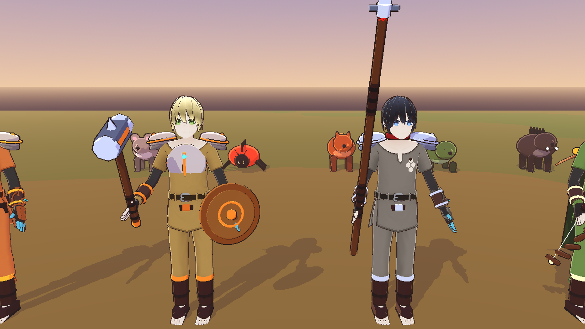
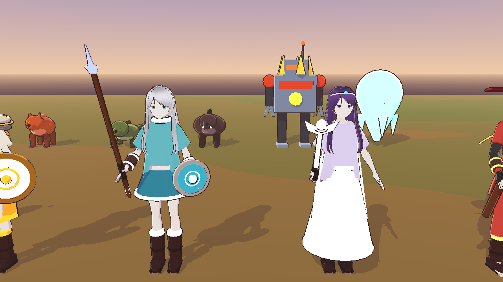
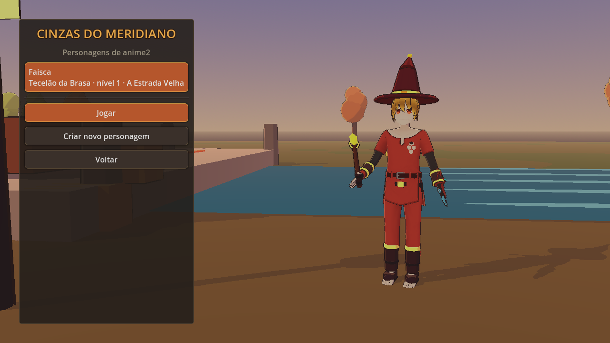
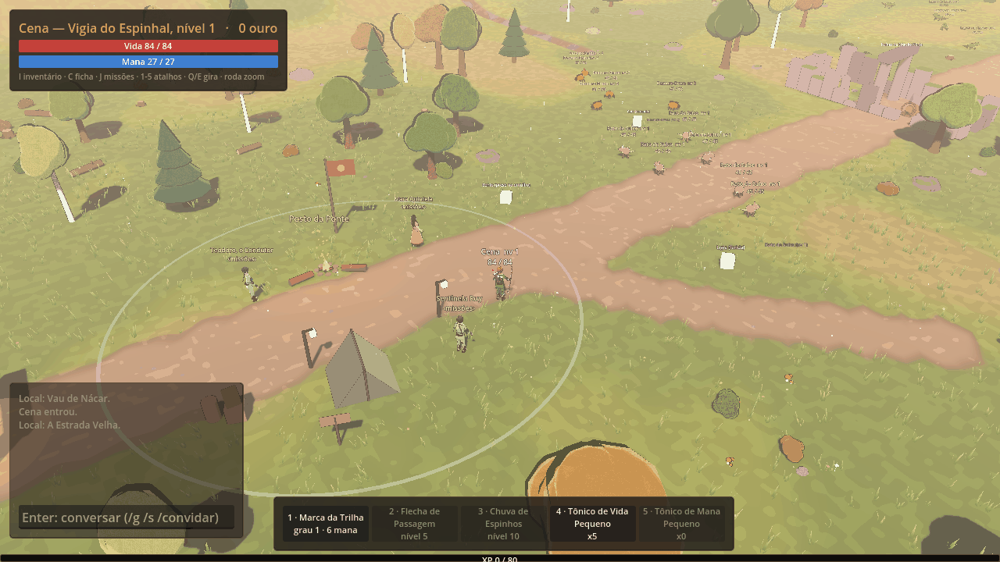
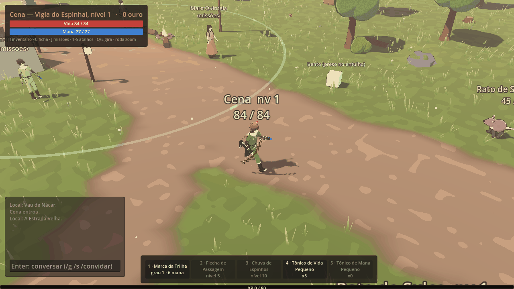
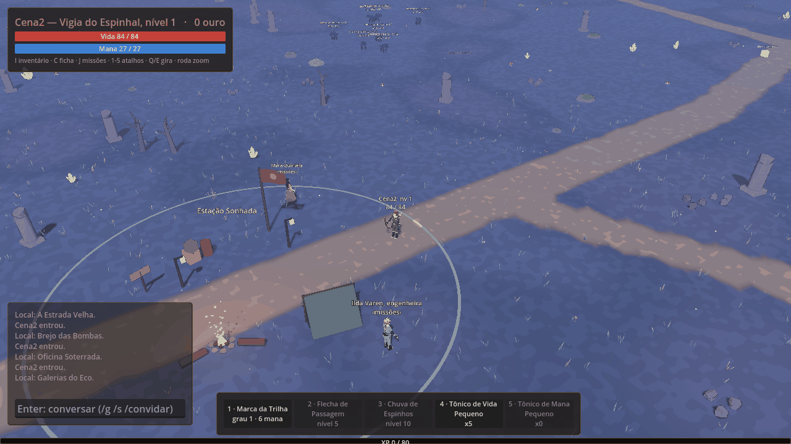
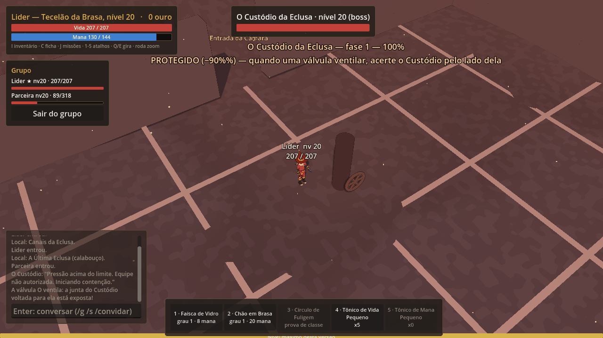

# CINZAS DO MERIDIANO

MMORPG 3D de ação PvE para PC, com câmera elevada, movimento por clique, caça em grupo em mapas compartilhados e equipamento que exige nível, classe e atributos. Cliente em **Godot 4**, servidor autoritativo de zona em **Node.js**, dados do jogo em **JSON editável**.

> Estado atual: **Marcos 1, 2 e 3 concluídos** — as 8 classes com todas as habilidades (níveis 1, 5, 10, 15 e 20), grupos de até 5, chat por canais, campanha dos capítulos 0 a 5 com missões secundárias, sete mapas abertos (Estrada Velha, Brejo das Bombas, Oficina Soterrada, Galerias do Eco, Canais da Eclusa e as duas cidades), prova de classe, ferreiro (+1 a +3), depósito da conta, elites diárias e o calabouço **A Última Eclusa** (Custódio em três fases para grupos de 2 a 5). Cliente em **3D estilizado com traço de anime** (personagens VRM, cenário com relevo, efeitos das habilidades, avisos do chefe), com **movimento fluido** (caminhos por A*, previsão do próprio personagem e interpolação dos outros). Próximo: Marco 4 (carga, ajuste e documentação final).

| | |
|---|---|
|  |  |
|  |  |
|  |  |
|  |  |
|  |  |
|  |  |

Personagens: modelos VRM de anime — **Seed-san model by VirtualCast, Inc.** e amostra VRM © 2022 pixiv Inc., ambos sob a VRM Public License 1.0 (detalhes em [docs/CREDITOS.md](docs/CREDITOS.md)).

*Capturas reais do cliente (Godot 4.3, renderização por software em Linux), geradas pelos modos `--navshots` e `--sceneshots`. Fluxo de telas em [docs/07-navegacao.md](docs/07-navegacao.md).*

## Documentação

| Documento | Conteúdo |
|---|---|
| [docs/01-visao.md](docs/01-visao.md) | Visão do jogo e o laço caçar → subir de nível → equipar |
| [docs/02-campanha.md](docs/02-campanha.md) | Abertura roteirizada, tutorial, os 5 capítulos com todas as missões principais, encontro com o Custódio, missões secundárias e pontos de caça |
| [docs/03-classes.md](docs/03-classes.md) | Fichas das 8 classes: papel, armas, atributos iniciais, kit, cada habilidade com custo, recarga, alcance, efeito e graus *(gerado dos dados)* |
| [docs/04-progressao-e-formulas.md](docs/04-progressao-e-formulas.md) | Tabela de XP 1–20, XP por monstro, exemplos solo e em grupo, equipamento por faixa (todas as famílias de arma em todas as faixas), verificação de requisitos, dois exemplos de evolução passo a passo, fórmulas com exemplos calculados *(gerado dos dados)* |
| [docs/05-arquitetura.md](docs/05-arquitetura.md) | Estrutura técnica, arquivos, protocolo, saque idempotente, reconexão, concorrência, critérios de aceitação dos 4 marcos, o que muda para teste público e múltiplas zonas |
| [docs/06-mundo-e-mapas.md](docs/06-mundo-e-mapas.md) | Cidades, cinco áreas, regras de monstros, morte e resgate, combate legível, telas da interface |
| [docs/07-navegacao.md](docs/07-navegacao.md) | Telas, camadas dentro do jogo, mapa do mundo, controles e direção gráfica |
| [docs/DECISOES.md](docs/DECISOES.md) | Todas as decisões tomadas por conta própria e o motivo |
| [docs/CREDITOS.md](docs/CREDITOS.md) | Créditos e licenças dos modelos de personagem |

## Requisitos

- **Espaço livre**: cerca de 1 GB (Node.js ~200 MB, Godot ~150 MB, projeto e dependências < 20 MB).
- **Node.js 22.13 ou mais novo** (recomendado: a versão LTS atual em <https://nodejs.org>, instalador `.pkg` para macOS; ou `brew install node`). Confira com:

```bash
node --version
```

- **Godot 4.3 ou mais novo** (versão padrão, não a .NET), em <https://godotengine.org/download>. No macOS, arraste `Godot.app` para `Aplicativos`.

## 1. Rodar o servidor

```bash
git clone https://github.com/rafaelallmark-commits/mmo.git
```

```bash
cd mmo/server
```

```bash
npm install
```

```bash
npm start
```

O servidor ouve em `ws://0.0.0.0:7777` e grava em `server/cinzas.db`. Para parar: `Ctrl+C` (salva todos os personagens conectados).

Variações:

```bash
npm run dev
```

liga os comandos de mestre (`--dev`). Argumentos diretos (depois de `--`):

```bash
npm start -- --port 7777 --db outro.db --xp-rate 1 --time-scale 1
```

## 2. Rodar dois clientes Godot na mesma máquina

Com o servidor rodando, de dentro da pasta `mmo` (raiz do repositório), abra **dois terminais** e rode em cada um:

```bash
/Applications/Godot.app/Contents/MacOS/Godot --path client
```

(No Linux/Windows, troque pelo caminho do executável do Godot.) Na primeira vez o Godot importa o projeto e cria `client/.godot/`: leva cerca de meio minuto, porque extrai as texturas dos modelos de personagem (≈ 60 MB a mais em disco).

Para já abrir com a conta preenchida:

```bash
/Applications/Godot.app/Contents/MacOS/Godot --path client -- --account=teste1 --password=teste123
```

**Alternativa pelo editor**: abra o Godot, *Importar* → selecione `client/project.godot`. Em *Depurar → Personalizar instâncias de execução…* (*Debug → Customize Run Instances…*), marque *Ativar múltiplas instâncias* e defina **2**. Aperte F5: duas janelas do jogo abrem.

Em cada janela: **Jogar** → servidor `ws://127.0.0.1:7777`, **Criar conta** (ou **Entrar**) → **Criar novo personagem** (escolha a classe; a prévia 3D muda) → **Jogar**. **Esc** fecha painéis ou abre o menu (Opções, Trocar de personagem, Sair para o título).

Controles: clique no chão anda; clique no monstro ataca; clique no NPC conversa (missões, loja, prova de classe); clique no anel de um portal muda de mapa; clique no saque coleta; **1–3** habilidades, **4/5** tônicos; **J** missões; chat com `/g` (grupo), `/s Nome` (sussurro), `/convidar Nome`, `/sair`; **I** inventário (clique no item equipa/usa; passe o mouse para ver a descrição e a comparação); **C** ficha (pontos e habilidades); **Q/E** ou botão direito arrastando giram a câmera; roda do mouse aproxima; **Enter** conversa; **Esc** fecha painéis.

Para jogar em rede local, rode o servidor em uma máquina e use `ws://IP-DA-MÁQUINA:7777` no campo Servidor.

## 3. Criar personagens de teste

Pela interface (tela de personagens) ou pela linha de comando, com o servidor parado ou rodando (o personagem não pode estar conectado). Dentro de `server/`:

```bash
npm run create-character -- --account teste1 --password teste123 --name Brakka --class breaker
```

```bash
npm run create-character -- --account teste2 --password teste123 --name Ilvo --class emberweaver
```

Opções: `--level N` (começa no nível N, com os pontos livres correspondentes), `--give ID_DO_ITEM` (repetível, coloca na bolsa), `--db arquivo.db`. Classes do M1: `breaker` (Quebraferro), `emberweaver` (Tecelão da Brasa). IDs de item estão em `data/items.json` (ex.: `axe_1h_t5` = Machado de Pedreira, `wand_t5` = Varinha de Vidro Fosco).

## 4. Testes automatizados

Dentro de `server/`:

```bash
npm test
```

Roda os 37 testes: unitários (regras, equipamento, navegação, coerência dos dados, as 40 habilidades) e os **testes de aceitação dos Marcos 1, 2 e 3**, que sobem um servidor real numa porta aleatória com banco temporário e conectam clientes simulados pelo mesmo protocolo do Godot. O do Marco 3 inclui o refino conferido em 10.000 tentativas, o depósito da conta, a elite diária e **três grupos de bots** (5 com tanque e curadora, 3 sem tanque, 2 jogadores) vencendo o Custódio reagindo aos avisos, com uma queda de conexão no meio. Só um deles, com a narração:

```bash
node --test --test-reporter=spec test/m3.test.js
```

Só o do Marco 1:

```bash
npm run test:acceptance
```

Validar os dados depois de editar `data/*.json`, e regenerar as tabelas da documentação:

```bash
npm run validate-data
```

```bash
npm run gen-docs
```

Teste automático do **cliente** (headless, contra um servidor rodando), da raiz do repositório:

```bash
/Applications/Godot.app/Contents/MacOS/Godot --headless --path client -- --autotest --server=ws://127.0.0.1:7777 --account=robo --password=robo123 --class=breaker --name=Robo
```

Ele cria a conta/personagem se preciso, entra no mundo pela mesma rotina da interface, anda até (30, 50), ataca um Rato de Sulco, coleta o saque e termina com `[autotest] OK` (código de saída 0). Mensagens `Parameter "m" is null` vêm do renderizador "dummy" do modo headless e são inofensivas.

Vitrine com as 8 classes, monstros e NPCs (salva capturas, inclusive closes do rosto):

```bash
/Applications/Godot.app/Contents/MacOS/Godot --path client -- --gallery=/tmp/vitrine
```

Percorrer todas as telas e salvar uma captura de cada (precisa de janela, não use `--headless`):

```bash
/Applications/Godot.app/Contents/MacOS/Godot --path client -- --navshots=/tmp/telas --server=ws://127.0.0.1:7777 --account=vitrine --password=vitrine123 --class=breaker --name=Brakka
```

Tour do cenário: teleporta (comando de mestre — servidor iniciado com `npm run dev`) por pontos de cada mapa, salva visão de jogo, ampla, de perto e uma sequência correndo, e mede a fluidez (velocidade quadro a quadro):

```bash
/Applications/Godot.app/Contents/MacOS/Godot --path client -- --sceneshots=/tmp/cenario --server=ws://127.0.0.1:7777 --account=cena --password=cena123 --class=warden --name=Cena
```

Ver o calabouço no cliente (servidor com `npm run dev`): um parceiro simulado entra no grupo e vai junto até a porta da Última Eclusa. Num terminal, dentro de `server/`:

```bash
node tools/partner.mjs ws://127.0.0.1:7777 Parceira
```

E, em outro terminal, da raiz do repositório:

```bash
/Applications/Godot.app/Contents/MacOS/Godot --path client -- --sceneshots=/tmp/eclusa --dungeon=Parceira --server=ws://127.0.0.1:7777 --account=lider --password=lider123 --class=emberweaver --name=Lider
```

Com `--trial` no lugar de `--dungeon=...`, o mesmo modo faz a prova de classe na arena.

## 5. Reproduzir os cenários críticos à mão

Prepare (servidor parado ou rodando):

```bash
npm run create-character -- --account cenario1 --password teste123 --name Cedo --class breaker --level 2 --give axe_1h_t5
```

```bash
npm run create-character -- --account cenario2 --password teste123 --name Pronto --class breaker --level 5 --give axe_1h_t5
```

```bash
npm run create-character -- --account cenario3 --password teste123 --name Faisca --class emberweaver --level 5 --give wand_t5
```

| Cenário | Passos | Resultado esperado |
|---|---|---|
| Ver o outro se mover | Entre com duas contas; numa janela clique no chão | A outra janela mostra o personagem andando até o ponto |
| Combate, XP e saque individual | Clique num Rato de Sulco até derrotá-lo | Números de dano, "+XP", saque só na sua tela; clique no saque para coletar |
| Equipar cedo demais | Entre com `cenario1`, **I**, passe o mouse no Machado de Pedreira e clique | Descrição com "Nível mínimo: 5", "Força 22 (você: 17)", "Talento 14 (você: 11)" em vermelho; mensagem **"Nível 5 exigido. Seu nível atual é 2."** |
| Atributos insuficientes → distribuir → equipar | Entre com `cenario2`, **I**, clique no machado | **"Força 22 exigida. Sua Força atual é 17."** Depois **C**, "+" em Força 5× e Talento 3×, **Confirmar pontos**, **I**, clique no machado: equipado |
| Duas mãos | Entre com `cenario3`, **I**, clique no Cajado de Aprendiz | Varinha e foco voltam para a bolsa; clicar no foco: **"A arma de duas mãos ocupa a mão secundária. Desequipe-a antes de usar este item."** |
| Redistribuição invalida equipamento | Com o machado equipado (cenário acima), **C** → **Redistribuir tudo** | "1 item(ns) voltaram para a bolsa"; machado na bolsa |
| Persistência | Equipe o machado, feche a janela, reabra e entre | Machado continua equipado. Também vale parando o servidor (`Ctrl+C`) e rodando `npm start` de novo |
| Reconexão | Com o cliente aberto, pare o servidor | Aviso "Conexão perdida" com **Reconectar**; suba o servidor e clique: volta ao mesmo personagem |
| Saque idempotente | Coberto pelo teste automático (pedidos repetidos e simultâneos só são possíveis pelo protocolo) | `npm run test:acceptance` mostra "4 pedidos do mesmo machado -> 1 instância" |

## Estrutura

```
data/     dados do jogo (classes, habilidades, itens, monstros, saque, mapas, XP, fórmulas)
server/   servidor autoritativo de zona (Node.js) + testes + ferramentas
client/   projeto Godot 4
docs/     design e arquitetura
```

Detalhes em [docs/05-arquitetura.md](docs/05-arquitetura.md).
