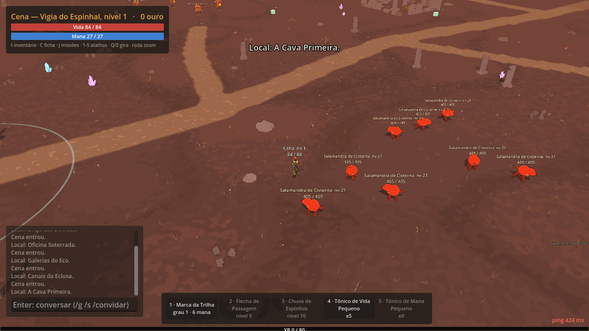

# 6. Cidades, áreas de caça, combate e interface

Complementa os itens 2 e 5. Os números de monstros (vida, dano, XP, agressão, perseguição, reaparecimento) estão em `data/monsters.json`; a tabela completa está em `04-progressao-e-formulas.md`.

## Regras gerais de monstros

| Regra | Valor (editável) | Efeito |
|---|---|---|
| Agressão | passivos: só reagem; agressivos: raio de 8 m (elite 10 m) | O jogador escolhe quando lutar com passivos; agressivos punem quem atravessa distraído. |
| Matilha | mesma espécie a até 8 m entra na luta quando uma é atingida | Cães de Ferrugem, Ratos-Engrenagem, Morcegos de Eco: puxar pela borda. |
| Perseguição (coleira) | 25 m da posição de origem | Ao passar disso o monstro volta, recupera a vida e esquece a ameaça. Impede arrastar monstros até a cidade. |
| Zona segura | raio de 12 m no posto de guarda | Monstros não iniciam agressão contra quem está dentro; não impede o jogador de lutar. |
| Ameaça | dano causado (×3 com Pulso de Atração, M2) | O monstro persegue quem gerou mais ameaça; Bastião e Escudeiro têm ferramentas para segurar. |
| Reaparecimento | normal 20 s, elite 120 s, chefe só por instância | Pontos de caça se mantêm vivos com 2–5 jogadores. |
| Saque | individual por participante (≥ 5% de participação) | Ninguém disputa saque; cada um vê só o seu. |

## As duas cidades

Ambas têm os mesmos serviços para que nenhuma origem fique em desvantagem: **mestre(s) de classe**, **ferreiro** (refino até +3), **comerciante de tônicos**, **depósito** (guarda-volumes compartilhado pelos personagens da conta, M3), **posto de guarda** (ponto de retorno) e **saída para a Estrada Velha**.

### Pedrâmbar (Âmbar) — oeste

Cidade de pedra cortada e vigas escuras, construída em terraços ao redor de uma antiga estação de superfície. Ruas largas para carroças.

- **Praça das Balanças** (centro): depósito, quadro de missões.
- **Pátio dos Mestres**: Mestre Tarrasco (Quebraferro), Mestra Ione do Bronze (Bastião), Sargento Bel do Fosso (Lanceiro), Vigia-Mor Cássia (Vigia).
- **Forja do Gusmão**: ferreiro.
- **Botica da Dona Resina**: tônicos.
- **Portão Leste** → Estrada Velha (Posto da Ponte a 2 minutos de caminhada).

### Vau de Nácar (Nacre) — leste

Cidade sobre pontes e plataformas acima de um rio, atravessada por condutores de nácar que brilham fracos à noite.

- **Plataforma do Relógio** (centro): depósito, quadro de missões.
- **Claustro dos Mestres**: Dama Aurélia (Escudeiro), Sina (Andarilha), Mãe Nívea (Cantora), Mestre Otan Cinzeiro (Tecelão).
- **Oficina de Tiela Martelo-Fino**: ferreira.
- **Boticário Lume**: tônicos.
- **Ponte Oeste** → Estrada Velha.

### Ferreiro (M3)

Refino de +0 a +3. Cada grau aumenta defesa/poder mágico em 10% (dano das armas: +1 no mínimo e no máximo por grau). A janela mostra **custo explícito** (ouro + materiais), **chance visível** e **prévia do efeito** antes de confirmar. Na falha, o grau se mantém e os materiais são consumidos.

| Grau | Chance | Custo (faixa N do item) | Material |
|---|---|---|---|
| +1 | 90% | 20 × N ouro | Sucata de Condutor ×3 |
| +2 | 70% | 45 × N ouro | Pó de Refino ×2 |
| +3 | 45% | 90 × N ouro | Pó de Refino ×4 + Brasa Cristalizada ×1 |

## As áreas de caça

Cinco áreas na versão 1 e, no pós-v1, a sexta (A Cava Primeira, níveis 20–25).

| Área | Níveis | Famílias | Caça solo | Caça em grupo | Rota de retorno | Motivo para voltar |
|---|---|---|---|---|---|---|
| **A Estrada Velha** | 1–5 | bestas (ratos, besouros, cães, lagartos, javalis) e uma máquina elite | Campo do Sulco, Encosta Morna, Leito Seco | Curva dos Cães (matilha), Capataz Rachado | Posto da Ponte no centro; cidades nas pontas | Capataz Rachado (arma de nível 5 da classe), Sucata de Condutor, família Bronze de Eclusa |
| **Brejo das Bombas** | 5–9 | bestas aquáticas, máquinas de pressão | Lagoa das Bombas, Margem Alta | Poço das Sanguessugas, Canal Raso, Bomba-Mestra | Acampamento da Comporta (posto) | Brasa Cristalizada, elite Bomba-Mestra, família Ferro Frio |
| **Oficina Soterrada** | 9–12 | máquinas de trabalho | Galeria dos Escavadores | Arquivo (enxames), Sala do Supervisor | Boca da Oficina (posto) | Pó de Refino, Supervisor de Turno, família Aço da Vigília |
| **Galerias do Eco** | 12–16 | espíritos sonoros, bestas térmicas, guardiões | Ninhos Térmicos | Salão dos Sinos (Ecoantes), Ponte dos Fios, Mãe do Eco | Estação Sonhada (posto) | Seda condutora para refino, Mãe do Eco, família Liga Rubra |
| **Canais da Eclusa** | 16–20 | máquinas da Eclusa, escória de vapor | Comporta Norte | Bacia de Vapor, Canal Lamacento, Fragmentos do Custódio | Comporta Norte (posto) | Chave de Comporta, calabouço da Última Eclusa, itens únicos de nível 20 |
| **A Cava Primeira** (pós-v1) | 20–25 | bestas do calor fundo, máquinas dos fundadores, vozes presas no metal | Margem da Cisterna (Salamandras, passivas) | Salão das Placas (Sineiros em bando), Poço Quente (Toupeiras), Selador da Porta Funda | Posto de Escuta (posto) | Faixa 21 em toda a Cava, chance de faixa 25, Selador (elite diária), capítulo 6 |

### A Estrada Velha (implementada no M1)

Mapa de 160 × 100 m. Coordenadas em `data/maps.json`.

```
 z=0 ┌──────────────────────────────────────────────────────────────┐
     │          Leito seco do rio (bloqueado)                         │
     │                ▓                                               │
     │        Besouros-Brasa (52,32)          Lagartos de Lastro      │
     │                ▓                       (104,36)                │
 z=50│ Posto da   Ratos de Sulco      ▓▓ Ruínas da                    │
     │ Ponte ◎    (44,50)             ▓▓ Estação Norte     Javalis de │
     │ (20,50)  ════ estrada velha ═══▓▓══════════════════  Cinza     │
     │                                                     (134,58)   │
     │        Capataz Rachado (44,72)        Cães de Ferrugem          │
     │        [elite]                        (88,68) [matilha]         │
z=100└──────────────────────────────────────────────────────────────┘
     x=0                                                         x=160
```

- **Solo**: ratos e besouros perto do posto (passivos, níveis 1–2), lagartos no leito seco (lentos, nível 4).
- **Grupo**: Curva dos Cães (agressivos, chamam os vizinhos), Capataz Rachado (elite de nível 4: dois jogadores de nível 1–2 vencem com tônicos; um jogador de nível 5 vence sozinho).
- **Retorno**: o Posto da Ponte é o ponto de retorno ao cair e a zona segura do mapa.

### A Cava Primeira (pós-v1, níveis 20–25)

Obras mais velhas que a Companhia e que as duas cidades: escadas talhadas, salões de placas de bronze, tubos de voz nas paredes e uma cisterna que o calor do fundo deixou morna. Entrada pelo **Poço de Inspeção** (90, 176) dos Canais da Eclusa, ao lado da porta da Última Eclusa — nível 20 exigido ("Nível 20 exigido para A Cava Primeira. Seu nível atual é 19."). Mapa de 220 × 160 m (o mesmo porte das Galerias do Eco), cenário gerado com semente fixa (`npm run gen-scenery`: 300 peças, 141 com colisão, 5 estradas).

```
 z=0 ┌──────────────────────────────────────────────────────────────────┐
     │ tubos de voz ·                                 ░                 │
     │   Salão das Placas         Vozes Soterradas    ░ Fenda           │
     │   Sineiros (64,34)         (124,32) [galeria]  ░ Funda    · selo │
     │                 ▓▓ Ruínas do                   ░         (204,60)│
     │                 ▓▓ Primeiro Posto              ░                 │
 z=80│◎ Posto de Escuta ══════ galeria principal ═════════════════ ◆ ▓▓▓│ Porta
     │ (22,80)       · máquina do posto (106,66)      ░  Selador     ▓▓▓│ Funda
     │      Salamandras (62,102)                      ░ · selo  · tubo  │
     │ ≈≈≈≈≈≈≈≈≈≈≈≈≈≈≈        Toupeiras (118,130)     ░  Toupeiras      │
     │ ≈ Cisterna Funda ≈                             ░  (184,122)      │
z=160└──────────────────────────────────────────────────────────────────┘
     x=0                                                             x=220
```

| Lugar | Coordenadas | O que tem |
|---|---|---|
| **Posto de Escuta** | (22, 80), zona segura de 12 m | Ponto de retorno; Mara, Ilda e Joca; Poço de Inspeção de volta aos Canais em (4, 80) |
| **Margem da Cisterna** | (62, 102) | Salamandras de Cisterna, nível 21, **passivas** (8): caça solo sem susto; a Cisterna Funda (água, bloqueada) fica ao sul |
| **Salão das Placas** | (64, 34) | Sineiros de Bronze, nível 22, agressivos e em bando (7); três tubos de voz nas bordas do salão (capítulo 6.2) |
| **Ruínas do Primeiro Posto** | (100–112, 50–62) | Máquina do posto antigo em (106, 66) (capítulo 6.3) |
| **Galeria Norte** | (124, 32) | Vozes Soterradas, nível 23, agressivas (6) |
| **Fenda Funda** | x 150–158 | Leito seco bloqueado de ponta a ponta; só a galeria principal atravessa (z 64–94) |
| **Poço Quente** e sul das ruínas | (184, 122) e (118, 130) | Toupeiras de Basalto, nível 24, agressivas (6 + 5): ponto de grupo |
| **Porta Funda** | ruínas em x 212–220, z 70–90 | Selador da Porta Funda (elite 24, diária) em (202, 80); três selos e o tubo de resposta (capítulo 6.4 e 6.5) |

- **Solo**: Salamandras (passivas) e Vozes puxadas uma por vez; os Sineiros chamam o bando inteiro quando um é atingido.
- **Grupo**: Toupeiras no Poço Quente e o Selador (elite diária: XP em dobro e saque extra no primeiro abate do dia, como a Mãe do Eco e o Fragmento do Custódio). Os selos e o tubo de resposta ficam a ~15–20 m do Selador, fora do raio de agressão de 10 m.
- **Saque**: todos os monstros normais rolam a faixa 21 (4%) e a 25 (0,4%); o Selador, a 21 (60%) e a 25 (12%). Os Canais da Eclusa e o Fragmento do Custódio passaram a ter chance pequena de faixa 21 (0,4% e 10%), seguindo o padrão de "próxima faixa" das outras áreas.
- **Visual**: famílias de monstro já existentes (bestas, máquinas, espíritos) com cores próprias; céu e névoa ocre-avermelhados, chão de terra aquecida, pouca vegetação e brasas subindo no ar (`client/scripts/scenery.gd`).



## Morte e resgate

- Ao cair, o personagem fica no chão. Opções: **voltar ao posto de guarda** (aparece com 50% de vida e mana) ou esperar **resgate por aliado** (Coro do Recomeço da Cantora no nível 20; no M2, qualquer aliado pode levantar um caído canalizando 5 s fora de combate, com 20% de vida). Não há perda de XP; o custo é tempo e deslocamento.
- **Queda de conexão durante a morte**: o servidor grava o estado "caído" imediatamente. Ao reconectar, o personagem reaparece no posto de guarda com 50% de vida (implementado no M1 em `Zone.addPlayer` e coberto pelo teste `server/test/death.test.js`).

## Combate legível

- Câmera elevada com zoom (roda do mouse) e rotação (Q/E ou botão direito arrastando).
- Clique no chão para andar; clique no monstro para selecionar e atacar (o servidor aproxima até o alcance da arma e ataca no intervalo dela).
- Barra de atalhos: 1 e 2 para habilidades, 3 e 4 para tônicos. Habilidade com alvo fora do alcance: o cliente aproxima primeiro; o servidor revalida o alcance.
- Números de dano flutuantes (branco: seu dano; laranja: mágico; amarelo com "!": crítico; vermelho: dano recebido; "errou").
- Anel de seleção amarelo sob o alvo; quadro do alvo com nome, nível, tipo (elite/chefe) e vida.
- Áreas de efeito desenhadas no chão durante toda a duração; perigos de chefe sempre com aviso visual + sonoro antes do dano.
- Legibilidade com muitos monstros: nomes e vida só como rótulo curto; cores por família; o próprio personagem com contorno da cor da classe.

## Interface (telas)

| Tela | Conteúdo | Estado |
|---|---|---|
| Login | servidor, conta, senha, criar conta | M1 |
| Seleção e criação de personagem | lista; nome + classe (com origem e papel) | M1 (2 classes), M2 (8) |
| Ficha (C) | atributos permanentes e com itens, pontos livres com "+", confirmar/desfazer, redistribuir; estatísticas derivadas; habilidades com graus | M1 |
| Barra de habilidades | 2 habilidades + 2 tônicos, com custo e nível de desbloqueio | M1 |
| Inventário e equipamentos (I) | espaços equipados, bolsa 30, caixa de recuperação; descrição com dano/defesa, raridade, nível, classe, atributos, empunhadura e espaço, requisitos pendentes em vermelho e comparação com o equipado | M1 |
| Chat | canal local da zona | M1 |
| Aviso de desconexão | motivo + "Reconectar" (refaz login e volta ao mesmo personagem) | M1 |
| Diário de missões | missões ativas, objetivo, progresso | M2 |
| Painel de grupo | membros, vida, mana, distância | M2 |
| Ferreiro | custo, chance, prévia | M3 |
