# 7. Estrutura de navegação

Como o jogador se move entre telas, painéis e mapas. Este documento manda: o cliente (`client/scripts/main.gd`) segue exatamente este fluxo.

## 7.1 Telas (fora do jogo)

```
                ┌──────────────┐
  abrir o jogo →│   TÍTULO     │── Opções ──► [Opções] ──► volta
                │ Jogar · Sair │── Créditos e licenças ──► CRÉDITOS ── Voltar ──► Título
                └──────┬───────┘
                       │ Jogar
                ┌──────▼───────┐
                │   ENTRAR     │── Voltar ──► Título
                │ servidor,    │── Criar conta (mesma tela; teste público: CRIAR CONTA ──► CONFIRMAR E-MAIL)
                │ conta, senha │── Confirmar e-mail ──► CONFIRMAR E-MAIL ──► Confirmar ──► Entrar
                │              │── Esqueci a senha ──► ESQUECI A SENHA ──► Trocar ──► Entrar
                └──────┬───────┘── login recusado: e-mail não confirmado ──► CONFIRMAR E-MAIL (conta preenchida)
                       │           termos novos ──► TERMOS ATUALIZADOS ──► Aceitar e entrar ──► Personagens
                       │ login ok
                ┌──────▼───────────┐
                │  PERSONAGENS     │── Voltar ──► Entrar (desconecta)
                │ lista + prévia 3D│── Baixar meus dados ──► BAIXAR MEUS DADOS ──► Voltar ──► Personagens
                │                  │── Excluir conta ──► EXCLUIR CONTA ──► Título (ou Cancelar)
                │                  │── Criar novo ──► CRIAÇÃO ──► Criar ──┐
                └──────┬───────────┘                    └── Voltar ──────┤
                       │ Jogar                                           │
                ┌──────▼───────┐ ◄───────────────────────────────────────┘ (volta à lista com o novo selecionado)
                │ CARREGANDO   │  nome do mapa + dica
                └──────┬───────┘
                       ▼
                    MUNDO
```

| Tela | Conteúdo | Saídas |
|---|---|---|
| **Título** | logotipo, cena 3D de fundo (ponte ao amanhecer), Jogar, Opções, Créditos e licenças, Sair; no rodapé, a versão inteira do cliente e o protocolo (ex.: "versão 0.4.0-teste.2 · protocolo 3", a mesma que vai no `/bug`) e o crédito dos modelos | Jogar → Entrar; Opções → painel; Créditos e licenças → Créditos; Sair → fecha |
| **Créditos** | abas Créditos (jogo e modelos VRM), Godot Engine (licença do motor e atribuições), Terceiros (componentes do motor, com direitos e licença) e Licenças (textos completos); o mesmo conteúdo do `LICENCAS-TERCEIROS.txt` dos pacotes | Voltar ou **Esc** → Título |
| **Entrar** | servidor, conta, senha; Entrar, Criar conta, Confirmar e-mail, Esqueci a senha, Voltar; erros em vermelho. O campo **Servidor** vem com o último servidor usado para entrar (guardado em `user://opcoes.cfg`) ou, na primeira vez, com o padrão da release; versão incompatível mostra onde baixar a nova, com um botão que abre a página | sucesso → Personagens; e-mail não confirmado → Confirmar e-mail (conta preenchida); termos novos → Termos atualizados; Voltar → Título |
| **Criar conta** (teste público) | conta, e-mail, senha; caixa de idade e de aceite; links dos Termos e da Política | Criar e receber o código → Confirmar e-mail; Voltar → Entrar |
| **Confirmar e-mail** | explicação, conta, código; Confirmar, Reenviar código, Esqueci a senha, Voltar; dica (validade, lixo eletrônico, limites) | Confirmar → Entrar com o aviso; Esqueci a senha → Esqueci a senha; Voltar → Entrar |
| **Esqueci a senha** | e-mail, Enviar código; código, nova senha, Trocar a senha | Trocar → Entrar; Voltar → Entrar |
| **Termos atualizados** | aviso com a versão nova, links dos Termos e da Política, caixa de aceite; Aceitar e entrar, Não aceito: baixar meus dados, Não aceito: excluir a conta, Voltar | Aceitar → Personagens; os dois "Não aceito" voltam aqui; Voltar → Entrar |
| **Personagens** | até 4 cartões (nome, classe, nível, mapa); personagem selecionado em 3D no centro, girando; Baixar meus dados, Excluir personagem, Excluir conta | Jogar → Carregando (com a conexão caída, o aviso fica na linha de status e Voltar leva a Entrar, D180); Criar novo → Criação; Baixar meus dados → Baixar meus dados; Excluir personagem → Excluir personagem; Excluir conta → Excluir conta; Voltar → Entrar |
| **Baixar meus dados** | o que vem no arquivo, senha, Baixar; depois: caminho do arquivo em `user://dados`, Abrir a pasta, Salvar uma cópia em outro lugar... | Voltar → Personagens (ou Termos atualizados) |
| **Excluir personagem** | aviso (itens, ouro, missões e clã; o depósito da conta fica), nome do personagem, senha da conta, Excluir personagem para sempre, Cancelar | Excluir → Personagens, com o aviso; Cancelar → Personagens |
| **Excluir conta** | aviso, senha, Excluir para sempre, Cancelar | Excluir → Título; Cancelar → Personagens (ou Termos atualizados) |
| **Criação** | 8 classes em dois grupos (Âmbar / Nacre), papel e armas da classe, prévia 3D muda ao escolher, nome | Criar → Personagens; Voltar → Personagens |
| **Carregando** | nome do mapa, dica de jogo; aparece ao entrar no mundo e em cada troca de mapa; uma queda de conexão a fecha | → Mundo (personagem novo: → Abertura) |
| **Abertura** | ~40 s na ponte antes do amanhecer (docs/02, "Abertura"): caravana, primeiro toque, sulco vermelho, a margem que cede e Mara entregando o mapa; legendas, sem interface. Só na primeira entrada de um personagem novo neste computador | Pular (Esc, Espaço, Enter ou botão) ou fim da cena → Mundo, no Posto da Ponte |
| **Opções** | sensibilidade da câmera, mostrar nomes, escala da interface; gráficos: modo leve, sombras, tela cheia, limite de quadros (salvos em `user://opcoes.cfg`, junto com o último servidor usado na tela Entrar); volume geral, da música e dos efeitos (salvos em `user://settings.cfg`) | Fechar → tela anterior |

## 7.2 Dentro do jogo: camadas

Da mais baixa para a mais alta. Uma camada de cima bloqueia o clique nas de baixo.

| Camada | O que é | Abre / fecha |
|---|---|---|
| 1. Mundo 3D | câmera elevada, personagens, monstros, NPCs, portais | clique: andar, atacar, falar, coletar |
| 2. HUD fixo | vida/mana/XP com os efeitos negativos e o tempo que falta, barra de atalhos (1–8), alvo (com a descrição do monstro), rastreador de missões, painel de grupo, chat; durante o tutorial, a dica do passo atual acima da barra de atalhos (sai da frente enquanto a bolsa, a ficha, o diário, o mapa ou o diálogo de um NPC estão abertos) | sempre visível |
| 3. Painéis | Inventário (**I**), Ficha (**C**), Missões (**J**), Clã (**L**), Mapa (**M**, com o Mapa da Estrada Velha na bolsa) — podem ficar abertos juntos | tecla ou **Esc** |
| 4. Diálogos | NPC (missões, loja, prova de classe, ferreiro), quadro de missões das praças, convites (grupo, troca, clã, duelo), janela de troca, ações sobre outro jogador | clique no NPC, no quadro ou no jogador / **Esc** (fechar a troca a cancela) |
| 5. Menu de pausa | Continuar, Opções, Reportar um problema (abre o chat com `/bug `), Trocar de personagem, Sair para o título, Sair do jogo | **Esc** sem nada aberto |
| 6. Avisos bloqueantes | Você caiu (voltar ao posto) · Conexão perdida (reconectar) | automático |

**Esc** fecha a camada aberta mais alta; sem nada aberto, abre o menu de pausa. O jogo não pausa (é online): o menu só cobre a tela.

**Trocar de personagem** desconecta e volta para Personagens (login refeito automaticamente); enquanto isso fica o painel **Voltando aos personagens**, com a linha de status e Voltar (→ Entrar): uma recusa do login (senha trocada em outro aparelho, servidor reiniciando) ou a queda da conexão aparecem nele (D180). **Sair para o título** desconecta e vai ao Título.

**Reconectar** (aviso de conexão perdida) refaz o login e volta ao mundo. Se o serviço de contas recusar pedindo o código do e-mail ou o aceite de termos novos, o jogo sai do mundo e abre *Confirmar e-mail* ou *Termos atualizados*, com a conexão nova aberta para a próxima tentativa; aceitos os termos, segue para Personagens.

## 7.3 Mapa do mundo

```
 Pedrâmbar ══ ◎ Posto da Ponte ══ A Estrada Velha (1–5) ══ Vau de Nácar
 (cidade Âmbar)  ponta oeste: todos               ║        (cidade Nacre)
                 começam aqui                     ║ trilha do Brejo, nível 5
              Brejo das Bombas (5–9) ═════════════╝
                       ║ nível 9
              Oficina Soterrada (9–12)
                       ║ nível 12 (M3)
              Galerias do Eco (12–16)
                       ║ nível 15 (M3)
              Canais da Eclusa (16–20) ──► A Última Eclusa (calabouço, 2–5 jogadores)
                       ║ nível 20 (Poço de Inspeção, pós-v1)
              A Cava Primeira (20–25)

 Mestres de classe (nas cidades) ──► Arena da Prova (instância solo, nível 10)
```

- Todo personagem começa no **Posto da Ponte**, na ponta oeste da Estrada Velha (17 m do portão de Pedrâmbar, 137 m da ponte de Vau de Nácar); a estrada entre os dois é segura para quem tem nível 2 (D164).
- Todo mapa tem um **posto de guarda** (zona segura e ponto de retorno ao cair).
- **Mapa** (**M**): com o Mapa da Estrada Velha na bolsa (recompensa do tutorial), mostra o mapa onde você está, de cima e com o norte para cima — estradas, áreas bloqueadas, portais com o destino e o nível, NPCs com nome, posto de guarda, você (seta) e o grupo. Vale em todos os mapas; sem o item, a tecla avisa "Você ainda não tem um mapa." Clicar no item na bolsa também abre.
- **Portais** ficam nas bordas, com o destino e o nível mínimo escritos acima; atravessar mostra a tela Carregando.
- Quem sai do jogo volta ao mesmo mapa e posição; quem sai dentro de uma instância volta à porta dela.

## 7.4 Controles

| Ação | Mouse / teclado |
|---|---|
| Andar | clique esquerdo no chão |
| Atacar / selecionar | clique no monstro |
| Falar, usar objeto, atravessar portal | clique no NPC, objeto ou anel do portal |
| Selecionar aliado (curas) e abrir as ações (Trocar, Duelar, Grupo, Clã, Sussurrar) | clique em outro jogador; na prova de classe, clique no aprendiz ou no peregrino para escolhê-lo como alvo das curas, escudos e do Juramento |
| Tirar a seleção do alvo | **Esc** (com um alvo selecionado, antes de abrir o menu; se o personagem estava batendo nele, para); sem alvo, golpes em cone ou em linha (Ruptura, Linha Partida, Flecha de Passagem...) saem para onde o cursor aponta |
| Atacar o oponente num duelo | clique nele (fora de duelo, jogador não é alvo) |
| Câmera | botão direito arrastando ou Q/E gira; roda aproxima |
| Atalhos | 1–6 habilidades (a 6ª é a do nível 25; a barra mostra a recarga; depois de cada habilidade há 1 s de recarga global), 7–8 tônicos (o mais forte do seu nível) |
| Conjuração | habilidades com tempo de conjuração mostram a barra "Conjurando…": fique parado; andar, atacar ou usar item interrompe sem gastar mana |
| Vender e descartar | bolsa (**I**), botão direito no item: **Vender** (com loja, ferreiro ou armeiro aberto; metade do valor) ou **Descartar…** (pede confirmação); item de missão (o Mapa da Estrada Velha e os materiais de coleta das secundárias) não tem essas opções |
| Painéis | I inventário, C ficha, J missões, L clã, M mapa (com o Mapa da Estrada Velha), Enter chat, Esc fechar painel, tirar a seleção do alvo ou abrir o menu (nessa ordem) |
| Chat | `/g` grupo · `/s Nome` sussurro · `/c` clã · `/convidar Nome` · `/troca Nome` · `/duelo Nome` · `/cla criar Nome SIGLA` · `/cla convidar Nome` · `/cla sair` · `/denunciar Nome motivo` · `/bug texto` (nome antigo com espaço entre aspas: `/s "Ana Maria" oi`) |

## 7.5 Direção gráfica: 3D estilizado com traço de anime

- **Sombreamento em faixas** (cel shading): luz e sombra em degraus nítidos, com a sombra puxando para um tom frio arroxeado em vez de preto.
- **Contorno** escuro e fino em personagens, monstros, NPCs e objetos (técnica de "casca invertida"); o seu personagem tem o contorno na cor da classe, que engrossa com a distância da câmera (2 a 3 pixels também com a câmera afastada), para achar a si mesmo no meio de uma briga.
- **Luz de borda** clara no lado oposto à câmera, para destacar silhuetas vistas de cima.
- **Proporções levemente estilizadas**: cabeça maior, olhos grandes e marcados, cabelo em volume colorido por classe; monstros com formas simples e olhos expressivos.
- **Cores**: saturadas, mas dentro da paleta de ferrugem e nácar (céu do amanhecer de violeta para pêssego, chão ocre, verde-oliva); vermelho reservado para perigo e requisitos não atendidos.
- **Cenário**: relevo suave com colinas além da borda e cordilheira no horizonte; estradas de terra (ruas calçadas nas cidades, trilhos na Oficina); grama que balança ao vento, flores e pedrinhas; árvores, pedras, arbustos, juncos, cristais e engrenagens desenhados exatamente onde o servidor tem colisão (`data/maps.json`, gerado por `npm run gen-scenery`); lagoa com vitórias-régias, leito seco escavado, ruínas da estação com o sino rachado, casa das bombas com chaminé fumegando, esteira da oficina; acampamento com fogueira (luz tremulante e brasas), barraca e bandeira em cada posto de guarda; cidades com muralha, casas e monumento na praça; portais em arco com véu de luz; pólen no ar. Céu com nuvens e névoa por mapa (amanhecer na Estrada, neblina esverdeada no Brejo, fumaça alaranjada na Oficina).
- **Nada esconde o personagem**: copas, casas e torres entre a câmera e quem joga ficam vazadas.
- **Som e música** (originais, sintetizados por `tools/audio/gerar_sons.py` e tocados por `client/scripts/audio.gd`): sinos, sopros e metal percutido, sem orquestra. A música é composta na hora a partir de notas pré-gravadas — sinos de carrilhão num modo de Ré, frases de flauta de madeira, bigorna, tanque e gongo — sobre um bordão em laço de cada clima: abertura (título), cidade (calma), caça (vento e sinos esparsos; cada mapa com seu modo, ecos nas Galerias, bigorna distante na Oficina), combate (sinos graves em ostinato e percussão, até ~6 s depois da última luta), calabouço e chefe, com crossfade entre eles. O motivo da abertura — o **primeiro toque** (um sino grave) e o **segundo toque** (duas batidas mais agudas) — volta na Última Eclusa como aviso de perigo. No mundo, cada som vem do lado e da distância de onde acontece (ouvinte logo acima do personagem, virado como a câmera); os passos seguem a passada da animação, em terra ou pedra conforme o mapa, e só de quem está perto. Cliques, painéis abrindo e fechando, erros, saque, tônicos, missão concluída, refino e a fanfarra de sinos do nível novo também soam. Volumes em **Opções**.

| | |
|---|---|
| 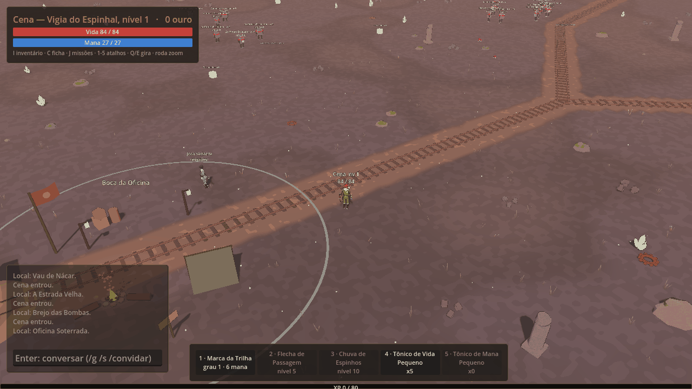 | 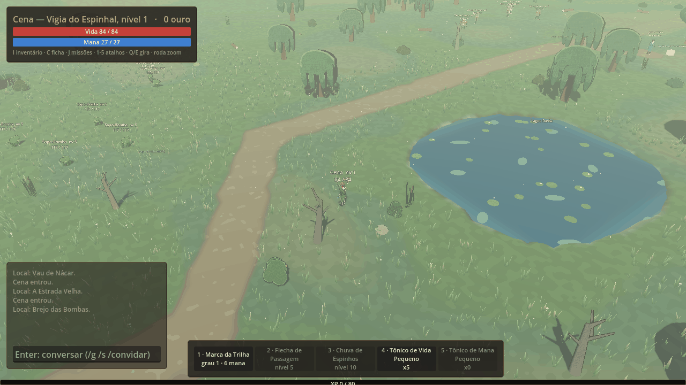 |

**Personagens:** modelos VRM de anime (Seed-san e a amostra da pixiv — créditos em `docs/CREDITOS.md`) com rosto pintado, cabelo e expressões (piscar, sorrir, cara brava ao atacar, careta ao apanhar). Cada classe recolore cabelo, olhos e roupa e ganha equipamento próprio preso aos ossos (`client/scripts/vrm_character.gd`, `client/scripts/gear.gd`). Monstros e cenário continuam montados por código no mesmo estilo (`client/scripts/art.gd`).

## 7.6 Movimento fluido

- **Clique e anda na hora**: o servidor devolve o caminho (A* com pontos de salto desviando de árvores, pedras e casas, em cerca de 1 ms mesmo de canto a canto nos mapas grandes) e o personagem segue imediatamente, acelerando em ~0,35 s e freando suave ao chegar; o marcador mostra o ponto livre mais próximo do clique.
- **Os outros** (jogadores e monstros) são desenhados 150 ms no passado, interpolados entre snapshots com as velocidades que o servidor envia: sem trancos, curvas redondas.
- **Corpo**: a passada acompanha a distância percorrida (sem pés deslizando), troca de andar para correr com a velocidade, inclina para a frente ao arrancar, para trás ao frear e para dentro das curvas; vira devagar (até ~10 rad/s) para onde anda ou para o alvo. Pernas por curvas de ângulos de quadril, joelho e tornozelo medidas em gente andando e correndo, com o quadril na altura que mantém o pé de apoio no chão e os braços balançando opostos às pernas. Parado, fica com o peso numa perna (contrapposto), respira, troca o apoio de vez em quando e olha em volta. Em guarda (com alvo), pé esquerdo à frente, joelhos flexionados, tronco de lado para o oponente e a cabeça compensando o giro para não tirar os olhos dele.
- **Armas na mão**: cada família tem empunhadura própria (mão certa — o arco vai na esquerda —, ponto do cabo na mão, cabo atravessando a palma na diagonal, gume alinhado com os nós dos dedos) e os dedos fecham no cabo. Lança, cajado, machado e espada de duas mãos, dardo, arco, varinha e cetro usam **poses guiadas pela arma**: a pose diz onde a arma fica e as mãos chegam até ela por cinemática inversa, com o cotovelo caindo naturalmente e o giro da mão dividido com o antebraço. Parado, a lança e o cajado ficam com o pé no chão e as armas de duas mãos descansam no ombro; correndo, a lança vai deitada ao lado do corpo; na guarda, a segunda mão pega no cabo. O arqueiro estende o braço do arco, puxa a corda até o queixo (a corda acompanha a mão) e solta; o dardo é arremessado por cima do ombro; a varinha aponta como um lápis.
- **Capítulo 4**: interações com tempo mostram uma barra de canalização ("não se mova"); a carroça da escolta aparece com a vida em cima e as mensagens da escolta (marcos, emboscadas, quebra, chegada) vão para o chat e para o centro da tela; respostas de diálogo aparecem como botões no painel do NPC, e o título ganho aparece acima do nome e na ficha.
- **Missões secundárias e diárias**: o **quadro de missões** das praças abre no painel de diálogo a lista do que dá para aceitar no mundo inteiro (título, nível, principal/secundária/diária, com quem falar e em que mapa) e as diárias já feitas hoje, com o tempo até voltarem (00:00 UTC); ofertas diárias aparecem como "(diária)" no NPC e no diário (**J**), e o diário lista as diárias de hoje com quando voltam. Materiais de coleta caem como saque individual comum; na bolsa, a dica e o menu do botão direito dizem que são itens de missão (sem venda nem descarte, e eles não aparecem para guardar no depósito nem para oferecer numa troca); o que cair depois da entrega some ao ser coletado, com o aviso no chat. Na defesa do Joca (2.2), o Joca com a vida em cima toma o lugar do NPC parado (clicar num monstro colado nele ataca o monstro; clicar no lugar vazio ainda abre a conversa), um cronômetro ("Válvula: 2:15") fica no alto da tela e cada onda, a queda e a vitória aparecem no centro; a esteira desgovernada da Oficina usa as mesmas faixas acesas do Custódio, mostradas só a quem está com a missão. Títulos ganhos (respostas e missões) são escolhidos na ficha (**C**), num seletor acima dos atributos.
- **Tutorial** («Três do Outro Lado»): Bento, Ligia e Caio aparecem como moradores (o menino menor), só para quem os resgata, com o nome e a situação em cima ("Ligia (ferida)", e a vida enquanto não está cheia); depois de soltos andam atrás do jogador, com passos próprios, e o que dizem sai num balão sobre a cabeça e no chat. O segundo toque soa com as duas batidas do sino e acende no relevo uma faixa vermelha sob o jogador, que estoura no fim do aviso.
- **Combate**: quem apanha recua um pouco e se encolhe; monstros sem arma dão um bote; quem cai tomba e afunda no chão.
- **NPCs** viram e olham para quem chega perto.
- **Câmera** segue com mola amortecida, olha um pouco à frente de quem corre, suaviza zoom e giro e não entra nos morros.

## 7.7 Combate e chefes na tela

- Cada habilidade tem efeito próprio: cortes em arco, flechas e bolas de energia (também nos ataques básicos à distância), leques, faixas, áreas no chão, colunas de cura, bolhas de escudo e espirais de enfraquecimento (`client/scripts/vfx.gd`).
- **Avisos de perigo** vêm do servidor (`warn`): anel âmbar diante da válvula que vai ventilar, linhas vermelhas no piso antes da descarga, círculos que enchem antes de explodir. E soam: o primeiro toque (sino grave) e o assobio de vapor crescendo na válvula que vai ventilar, o segundo toque (duas batidas) antes das linhas; na fase 3 as comportas rangem e o apito da eclusa dispara. A música muda para a do chefe quando a luta começa.
- **Golpes avisados dos monstros** (docs/06, "Mecânicas dos monstros") usam o mesmo aviso, com a forma do golpe: círculo em volta do monstro ou sob os pés da vítima (a área inteira marcada de leve, a borda forte e o vermelho enchendo do centro até o golpe), cone à frente (as duas bordas e o arco acesos, o leque cada vez mais vermelho) ou linha (a faixa com as bordas acesas). As marcações usam vermelho comum, não luz somada, para ler igual na grama clara e na pedra escura, e acompanham o relevo do chão (cada ponto da marcação fica logo acima do terreno ali, então a borda não some numa elevação). O monstro recua, treme e vira para onde vai golpear enquanto prepara, o sino toca no lugar dele (só a até 60 m de quem joga) e, se o golpe for cancelado (`warn_cancel`: monstro atordoado, morto ou fora da luta no meio do aviso), a marcação some. O fim de cada golpe tem efeito próprio: explosão com fumaça (Sapo-Bomba, Escória, vapor da Bomba-Mestra), ondas do grito (Morcego, Mãe do Eco, Selo), choque do fio, faíscas do soldador, rastro da investida e da corrida no trilho. Outros eventos (`mech`): corrente do puxão da Draga, "−N mana" azul na drenagem da Sanguessuga, onda e projétil do eco, anel dos reforços chamados e brilho da troca de pressão.
- **Efeitos negativos** (`debuff`/`cleanse`): sob as barras de vida e mana aparece cada efeito com o tempo que falta (Atordoado, Desorientado, Atolado, Sanguessuga, Selado; o texto do efeito na dica do mouse), com um aviso no centro da tela na primeira vez; sobre o personagem (o seu e o dos outros), um anel que gira — acima da cabeça, no peito ou nos pés. A Alvorada apaga a marca. Lentidão muda a velocidade da previsão do movimento na hora (`speed`), e atordoamento ou puxão param a previsão, para o personagem não seguir andando na tela enquanto o servidor o segura.
- **Quadro do alvo** (alto da tela, 460 px): nome, nível, tipo e vida, a pressão da Bomba-Mestra quando for ela, e a descrição do monstro numa linha — o que ele faz (até 80 caracteres, conferido pelo `validate-data`; o texto inteiro também na dica do mouse). Os avisos do centro da tela e o painel do chefe ficam logo abaixo dele.
- No calabouço, o painel do chefe (alto da tela) diz a fase, a vida e o que fazer agora; as comportas descem de verdade na câmara e o alarme pisca na fase 3.

| | |
|---|---|
| 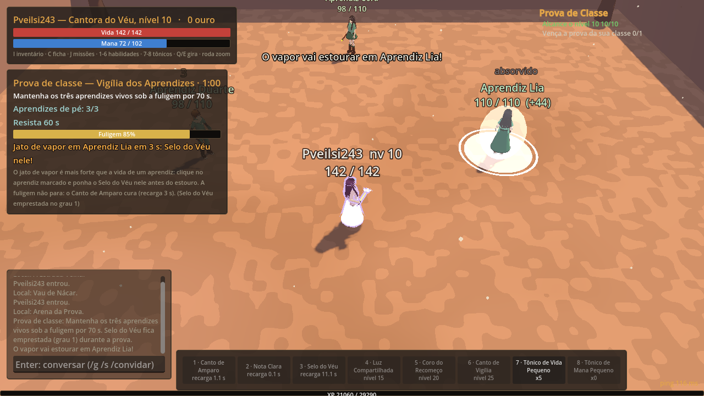 | 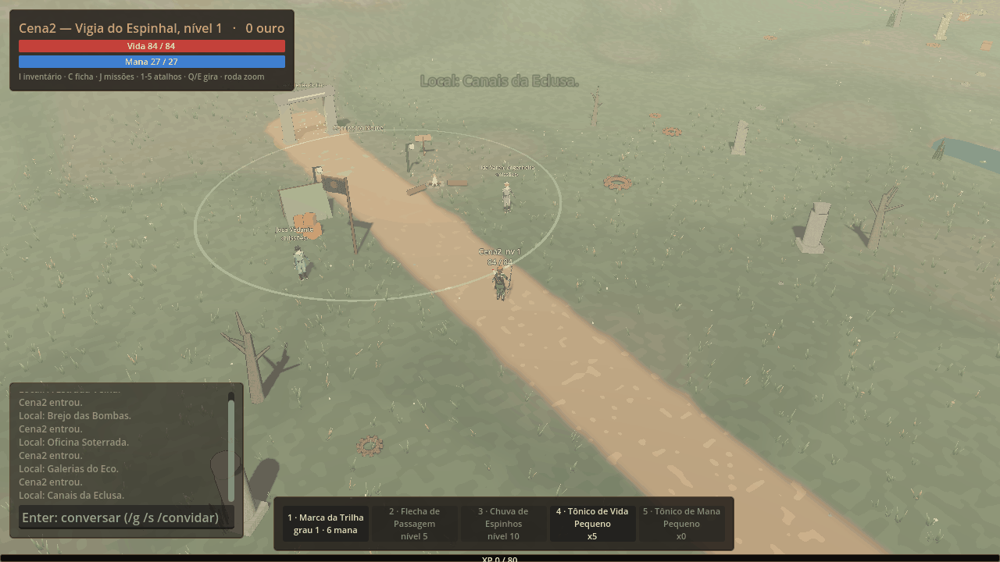 |

### Prova de classe na tela

- Antes de começar, a conversa com o mestre mostra a prova da classe: nome, tempo, objetivo, a dica e qual habilidade fica emprestada.
- Ao entrar na Arena da Prova, um **painel à esquerda** (abaixo da vida e da mana; o painel do grupo desce para baixo dele) mostra o nome da prova e o tempo que falta, o objetivo, o progresso ("Pilares rompidos: 1/3", "Aprendiz Brás: 300/420", "Alvos derrubados: 9/16"...) com uma barra, o **aviso da vez** em laranja (investida em 3 s, jato de vapor no aprendiz marcado, emboscada no marco, "fora do posto de tiro", a dica do cone da Ruptura) e, nos primeiros 15 s, a dica da habilidade emprestada. Vitória, derrota ou queda fecham o painel.
- A habilidade do nível 10 aparece na barra como **"emprestada"** enquanto a prova durar.
- No chão: os **fossos** do Lanceiro (vala escura com beiradas de pedra), o **posto de tiro** do Vigia (área marcada), as **filas** de bonecos (verdes quando caem inteiras), os **marcos** e o caminho pontilhado do peregrino, os **números dos sinos** da Andarilha (o da vez em âmbar, os feitos em verde) e a **linha de contenção** do Tecelão. As pedras do teto e os jatos de vapor vêm com o círculo de aviso que enche antes de cair.
- Peças da prova com modelo próprio: pilar de pedra com placas rebitadas (as placas caem, com lascas, e aparecem rachaduras incandescentes quando a Ruptura racha), boneco de palha num poste (cai de lado e volta a ficar de pé), alvo pintado sobre rodas, sino num poste que acende quando é a vez, atirador com besta, perseguidor com barbatanas; aprendizes e peregrino como moradores com varinha ou cajado, nome e vida em verde.

| | |
|---|---|
| 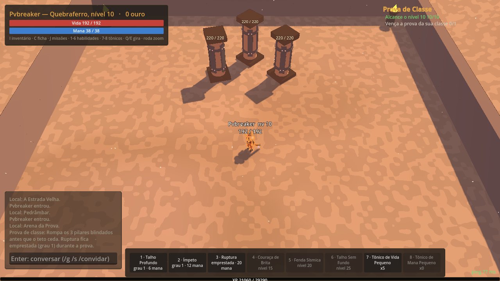 | 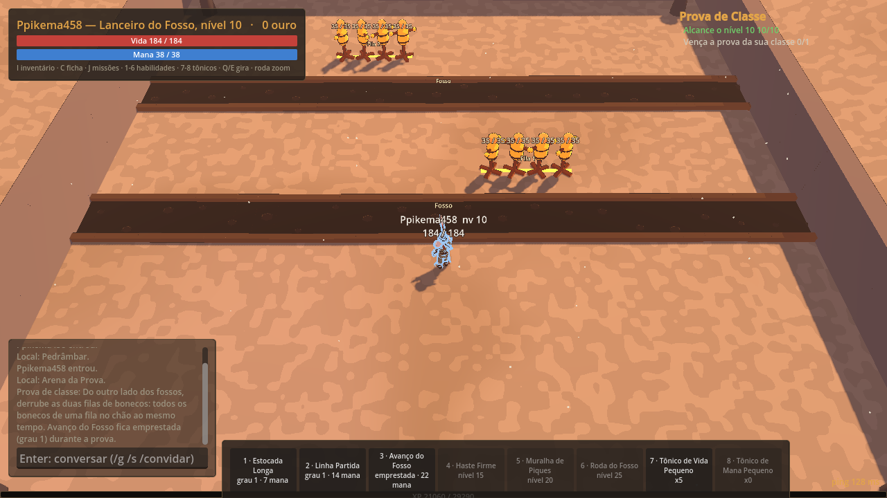 |

## 7.8 Social: troca, clã e duelo

- **Troca**: pedido (ações do jogador ou `/troca Nome`) → o outro aceita → cada um clica nos itens da bolsa
  para pô-los na oferta e define o ouro → os dois **travam** → os dois **confirmam**. Qualquer mudança de
  oferta destrava os dois lados e mostra um aviso ("a oferta mudou — confira"). Afastar-se, cair ou mudar
  de mapa cancela.
- **Clã** (**L**): sem clã, o painel mostra o formulário de fundação (nível 10, 500 de ouro); com clã, a lista
  de membros (on-line primeiro, por cargo) e, conforme o cargo, promover/rebaixar, passar a liderança,
  expulsar, convidar e mudar a mensagem do dia. A sigla aparece antes do nome de todos os membros.
- **Duelo**: desafio (ações do jogador ou `/duelo Nome`) → aceite → contagem de 3 s no alto da tela →
  "DUELO contra X" enquanto valer. Clique no oponente para atacar; habilidades de alvo único também valem.
  Ninguém morre: quem chegaria a 0 fica com 1 de vida e perde.
- **Ferreiro**: até +6; a partir de +3 → +4 a cotação mostra o risco ("se falhar, cai para +N") e a caixa
  **Usar Selo de Proteção**.

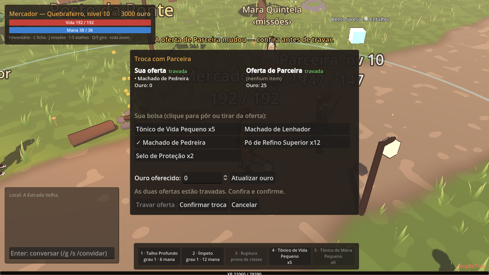
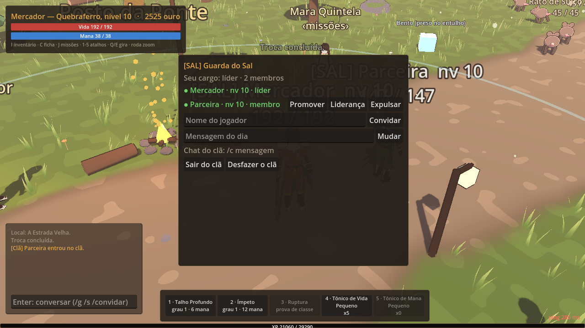
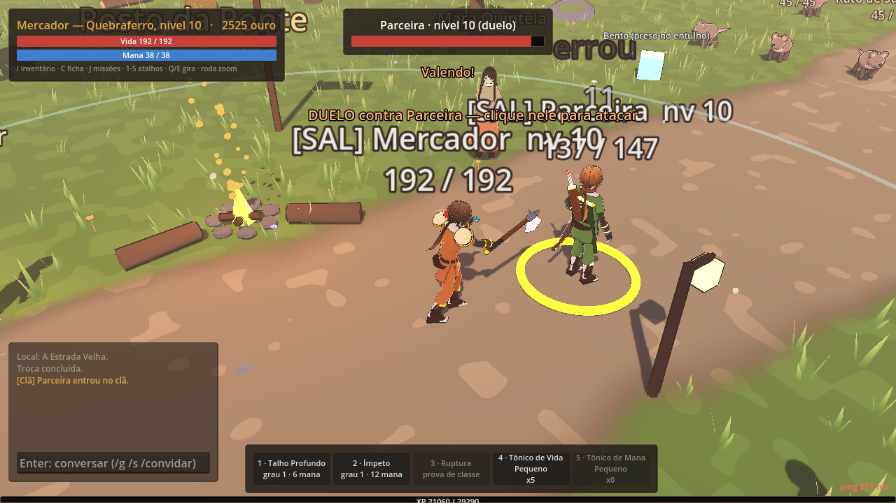
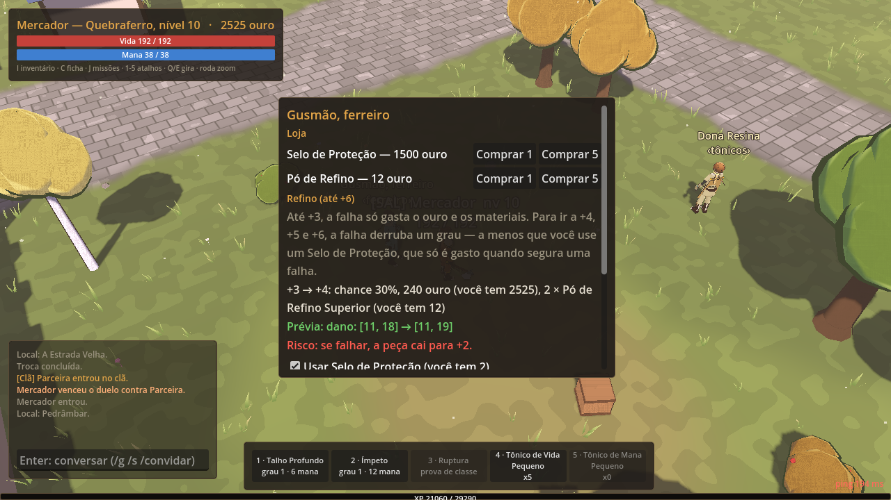
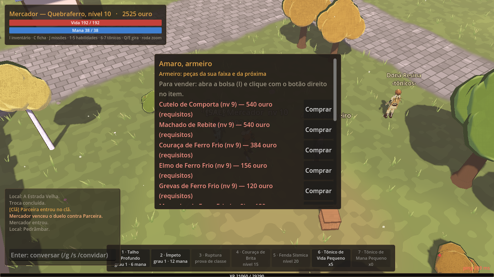
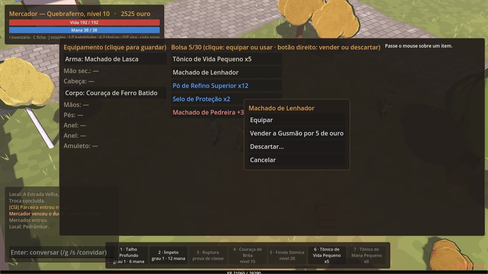
